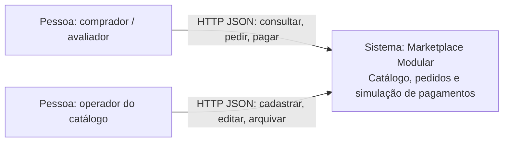
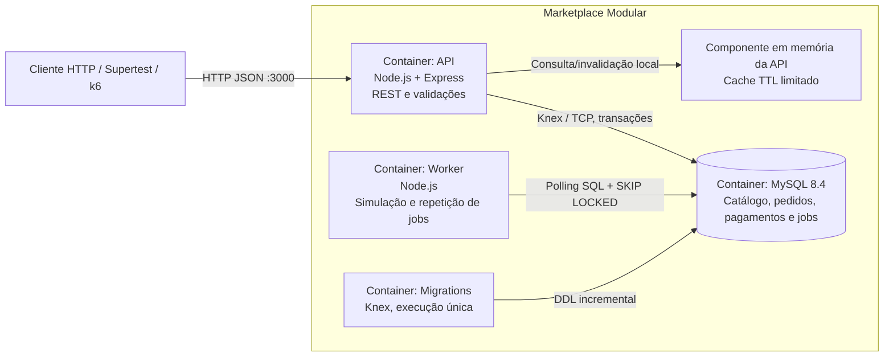
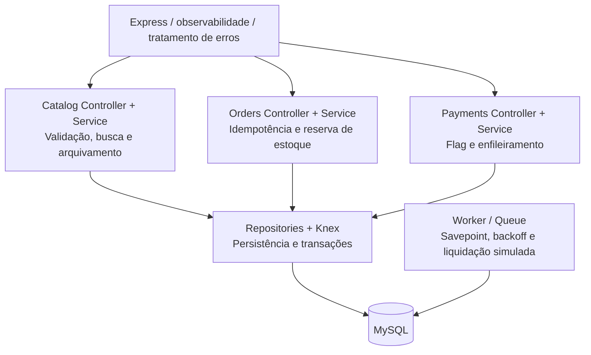

# Arquitetura C4

Diagramas em Mermaid, visualizáveis no GitHub e em editores compatíveis. Limites representam níveis C4; relações indicam direção e tecnologia.

## Nível 1 — Contexto

Não existe provedor financeiro externo. Comprador e operador são papéis conceituais; esta API local não implementa autenticação ou diferenciação de permissões.

## Nível 2 — Containers

O cache é desenhado como componente interno, não como serviço Docker independente. `test-db` e `tests` são containers auxiliares de verificação, separados do armazenamento de desenvolvimento.

## Nível 3 — Componentes da API e processamento

## Estados e consistência

Pedido: `pendente → pago` quando aprovado; `pendente → cancelado` quando recusado. Pagamento: `pendente → aprovado|recusado`. Job: `pendente → concluido` ou repetição com contador, chegando a `falhou` após cinco tentativas.

Criação de pedido decrementa estoque, grava pedido e itens no mesmo commit. Criação de pagamento grava pagamento e job no mesmo commit. Worker altera pagamento/pedido, restitui estoque quando necessário e conclui job no mesmo commit. IDs únicos de pedido/pagamento e chaves idempotentes são protegidos por índices no banco.
